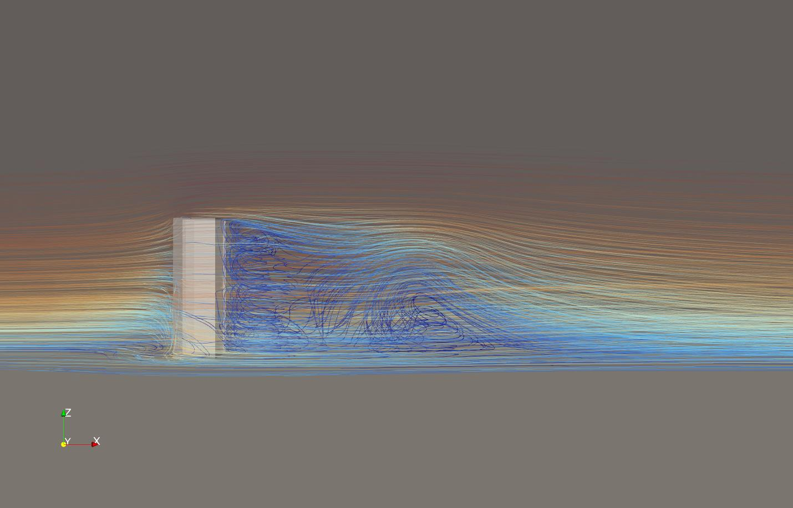
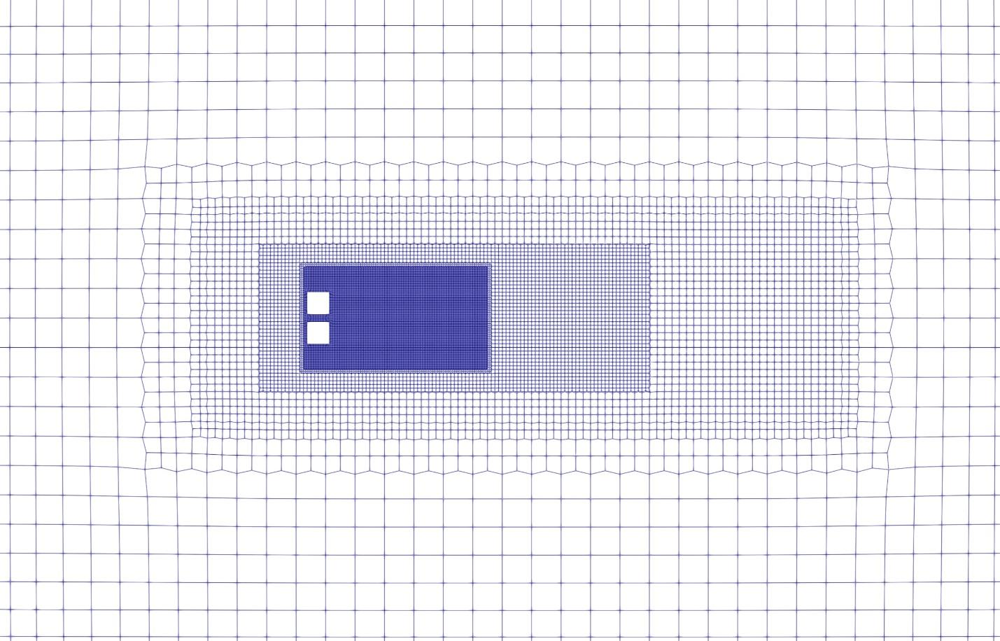

# Flow between buildings in the atmospheric boundary layer

Petar Turčić, Ivan Batistić

This case is based on the undergraduate thesis *Numerical analysis of the flow between buildings in the atmospheric boundary layer*, University of Zagreb, Faculty of Mechanical Engineering and Naval Architecture, 2026, https://urn.nsk.hr/urn:nbn:hr:235:401161

The case uses the **shear stress-driven** ABL model with the **successor** technique. It extends `tutorials/shearStressDriven/successor` with an object of interest: a building is added to a three-dimensional domain.

## Purpose

- Run a steady RANS simulation of the wind around a building using `simpleFoam`.
- Build the mesh with cfMesh (`surfaceToFMS`, `surfaceFeatureEdges`, `cartesianMesh`) from named STL surfaces.
- Monitor the residuals and the total force on the building (`forces-building`) and plot them with Gnuplot.

## ABL settings

| Setting | Used in this case |
|---|---|
| ABL modeling approach | Shear stress-driven: the flow is driven by a shear stress prescribed at the top boundary |
| Domain technique | Successor: analytical profiles are prescribed at the inlet, so no precursor simulation is needed |
| Base case | `tutorials/shearStressDriven/successor` |
| Stratification | Neutral |
| Inlet profiles | Log-law profiles of `U`, `k` and `epsilon` (`atmBoundaryLayerInletVelocity`, `atmBoundaryLayerInletK`, `atmBoundaryLayerInletEpsilon`) |
| Top boundary | `fixedShearStress` for `U`, fixed values of `k` and `epsilon` |
| Ground | Rough-wall functions with the roughness length z0 (`atmNutkWallFunction`, `atmEpsilonWallFunction`) |
| Turbulence model | k–ε with Cmu = 0.09, C1 = 1.44, C2 = 1.92 and sigmaEps = 1.11 |
| Custom library | Not needed: the library in `src` is used only by the pressure-driven inlet profiles |

The ABL parameters are set in `0/include/ABLConditions`:

| Quantity | Value | Meaning |
|---|---|---|
| `kappa` | 0.40 | von Kármán constant |
| `Cmu` | 0.09 | turbulence model constant |
| `flowDir` | (1 0 0) | wind direction |
| `zDir` | (0 0 1) | ground-normal direction |
| `Uref` | 20 | reference speed (m/s) |
| `Zref` | 10 | reference height (m) |
| `z0` | 0.41 | aerodynamic roughness length of the ground (m) |
| `d` | 0 | zero-plane displacement (m) |
| `kInit` | 0.5 | initial value of k in the internal field (m²/s²) |
| `epsilonInit` | 0.1 | initial value of epsilon in the internal field (m²/s³) |
| `nutInit` | 0 | initial value of nut in the internal field (m²/s) |
| `topSS` | (6.118 0 0) | kinematic shear stress at the `top` patch (m²/s²) |
| `topK` | 20.39 | k at the `top` patch (m²/s²) |
| `topEpsilon` | 0.1259 | epsilon at the `top` patch (m²/s³) |

The wind blows in the +x direction with a speed of 20 m/s at a height of 10 m. The friction velocity is u* = κ · Uref / ln((Zref + z0) / z0) ≈ 2.47 m/s, and the wind speed at the building top (z = 50) is about 30 m/s.

The values at the `top` patch correspond to the ABL profile at the domain height z = 300:

- `topSS` = u*²
- `topK` = u*² / √Cmu
- `topEpsilon` = u*³ / (κ (z + z0))

They must be recalculated if the domain height, the roughness length or the reference speed is changed.

## Case overview

The case consists of one tall building on flat ground inside a box-shaped domain. The building is 15 m × 15 m in plan and H = 50 m high, and it occupies x = 0 to 15, y = −20 to −5 and z = 0 to 50.

**Note:** the domain contains only one building and represents one half of the full problem. Both lateral boundaries are symmetry planes. The `left` plane at y = −2.5 is 2.5 m away from the building face at y = −5, so the building behaves as if it had a mirror image, and the two buildings are separated by a 5 m gap.

In terms of the building height, the inlet is 5 H upstream of the building and the outlet is 10 H downstream of it. The domain is 6 H high and extends 5 H from the building to the `right` plane.

### Domain surfaces

The domain is bounded by seven named surfaces, with one STL file for each in the `stl` directory:

| STL file | Patch name | Position | Boundary condition |
|---|---|---|---|
| `FRONT.stl` | `inlet` | x = −250 | ABL profiles of velocity, k and epsilon |
| `BACK.stl` | `outlet` | x = 515 | fixed pressure (0), `inletOutlet` for U, k and epsilon |
| `BOTTOM.stl` | `bottom` | z = 0 | ground wall, wall functions with roughness (`z0`) |
| `BUILDING.stl` | `building` | x = 0 to 15, y = −20 to −5, z = 0 to 50 | no-slip wall, the force is monitored here |
| `TOP.stl` | `top` | z = 300 | fixed shear stress, fixed k and epsilon |
| `LEFT.stl` | `left` | y = −2.5 | symmetry |
| `RIGHT.stl` | `right` | y = −270 | symmetry |

### Case files

| File | Purpose |
|---|---|
| `Allrun` | Generates the mesh (if it does not exist), runs the solver (in serial or in parallel) and creates the plots |
| `Allclean` | Restores the case to its initial state and removes the `*.pdf` plots and the generated surface files |
| `stl/BACK.stl`, `stl/FRONT.stl`, `stl/LEFT.stl`, `stl/RIGHT.stl`, `stl/TOP.stl`, `stl/BOTTOM.stl`, `stl/BUILDING.stl` | One surface per file; the `solid` name inside the file becomes the patch name |
| `domain.stl` | Created by `Allrun` by concatenating all files in the `stl` directory |
| `domain.fms`, `domain_edges.fms` | cfMesh surface and feature-edge files generated by `Allrun` |
| `Forces.gnuplot` | Plots the three components of the total force on `building` to `Forces.pdf` |
| `Residuals.gnuplot` | Plots the residuals from `log.simpleFoam` to `Residuals.pdf` |

The case also contains `system/meshDict`, `controlDict`, `fvSchemes`, `fvSolution` and `decomposeParDict`, `constant/transportProperties` and `turbulenceProperties`, and the initial fields `U`, `p`, `k`, `epsilon`, `omega` and `nut`. The fields read their parameters from `include/ABLConditions`.

## Running the case

OpenFOAM and cfMesh (for `cartesianMesh`) are required; Gnuplot is needed only for the plots. If cfMesh is not available, `Allrun` stops with an error message. The case was set up for OpenFOAM v2512.

```bash
./Allrun            # serial run
./Allrun parallel   # parallel run (uses system/decomposeParDict)
./Allclean          # restore the case to its initial state
```

The script performs the following steps:

1. `restore0Dir` copies `0.orig` to `0`.
2. The mesh is generated:
   1. `cat stl/*.stl > domain.stl` merges the seven files into one STL file with several `solid` blocks.
   2. `surfaceToFMS` converts `domain.stl` to `domain.fms` and keeps the patch names.
   3. `surfaceFeatureEdges -angle 45 domain.fms domain_edges.fms` extracts the edges sharper than 45° (the corners and the roof edges of the building).
   4. `cartesianMesh` generates the mesh according to `system/meshDict`.
   5. `renumberMesh -overwrite -constant` reduces the bandwidth of the matrix.
   6. `checkMesh -allTopology -allGeometry -constant` checks the mesh quality.
3. `simpleFoam` is run, either directly or through `decomposePar`, `runParallel` and `reconstructPar`, for the number of iterations set in `controlDict`.
4. The plots `Forces.pdf` and `Residuals.pdf` are created.

Mesh generation is skipped when `constant/polyMesh` exists, so run `./Allclean` after changing `meshDict` or any of the files in the `stl` directory. The meshing logs are `log.surfaceToFMS`, `log.surfaceFeatureEdges`, `log.cartesianMesh` and `log.checkMesh`, and the solver log is `log.simpleFoam`. The results can be inspected with `paraFoam`.

The `scaleSurfaceMesh` line in `Allrun` is commented out; enable it only if the CAD geometry was exported in millimetres.

## Case settings

Only the settings relevant for this tutorial are listed below.

### Mesh: `system/meshDict`

cfMesh reads `domain_edges.fms` (written by `surfaceFeatureEdges` in `Allrun`) and uses the given `maxCellSize`. The local cell size is set by three refinement boxes (`objectRefinements`):

| Box | `cellSize` | Centre | Size (x, y, z) | Covered x range |
|---|---|---|---|---|
| `box1` | 1 | (60, −2.5, 0) | 135 × 80 × 120 | −7.5 to 127.5 |
| `box2` | 5 | (95, −2.5, 0) | 220 × 100 × 134 | −15 to 205 |
| `box3` | 10 | (125, −2.5, 0) | 2000 × 1000 × 200 | the whole domain |

The boxes are centred at z = 0, so only their upper half lies inside the domain. With the wind in the +x direction, `box1` covers the building (x = 0 to 15) and about the first 112 m behind it, `box2` extends the refinement to x = 205, and the far wake is resolved with cells of size 10.

Boundary layers: 3 layers with `thicknessRatio 1.2` on `building`; `maxFirstLayerThickness 5` limits the layer thickness as a precaution. `excludedPatches` lists `inlet`, `outlet`, `top`, `bottom`, `left` and `right`.

### `system/controlDict`

`simpleFoam` is the solver, `endTime` is the number of iterations, `deltaT` has no physical meaning in a steady simulation such as this one, and `writeInterval` is the number of iterations between two writes of the results. The function object `forces-building` monitors the patch `building` and writes the forces and moments to `postProcessing/forces-building/`, which is read by `Forces.gnuplot`.

### Numerics

- `fvSolution`: `p` is solved with `GAMG`, and `U`, `k` and `epsilon` with `smoothSolver`. The under-relaxation factors are 0.15 for `p` and 0.5 for `U`, `k` and `epsilon`. There is no `residualControl`, so the number of iterations set in `controlDict` is always performed.
- `decomposeParDict`: the domain is split into `numberOfSubdomains` subdomains with the `hierarchical` method and `n (6 1 1)`, that is, into 6 parts in the x direction. Change `numberOfSubdomains` and `n` (their product must match) to the number of processor cores you want to use.

### Boundary conditions

| Patch | `U` | `p` | `k` | `epsilon` | `nut` |
|---|---|---|---|---|---|
| `inlet` | `atmBoundaryLayerInletVelocity` | `zeroGradient` | `atmBoundaryLayerInletK` | `atmBoundaryLayerInletEpsilon` | `calculated` |
| `outlet` | `inletOutlet` | `uniformFixedValue` 0 | `inletOutlet` | `inletOutlet` | `calculated` |
| `bottom` | `noSlip` | `zeroGradient` | `kqRWallFunction` | `atmEpsilonWallFunction` | `atmNutkWallFunction` |
| `building` | `noSlip` | `zeroGradient` | `kqRWallFunction` | `epsilonWallFunction` | `nutkWallFunction` |
| `top` | `fixedShearStress` | `zeroGradient` | `fixedValue` | `fixedValue` | `calculated` |
| `left`, `right` | `symmetry` | `symmetry` | `symmetry` | `symmetry` | `symmetry` |

## Expected results

Streamlines around the building:



Horizontal section of the mesh, with the domain mirrored about the `left` symmetry plane so that both buildings are shown:



**Residuals:** `Residuals.pdf` shows the residuals of `Ux`, `Uz`, `p`, `k` and `epsilon` from `log.simpleFoam`. They should decrease steadily and then level off. Since there is no `residualControl`, assess the convergence from the residuals and from the force plot.

**Forces:** `Forces.pdf` contains three plots: the x, y and z components of the total force on `building`. With the wind in the +x direction, the dominant force (drag) should be the x component and it should be positive. As a rough order-of-magnitude check: with Cd ≈ 1.3 (an assumption for a square column), a speed of about 25 m/s at mid-height, ρ = 1.25 kg/m³ and a frontal area of 750 m², the drag is of the order of 4 · 10⁵ N. This is only a hand estimate and not a simulation result. The force should settle at a constant value; if it keeps oscillating, the flow is probably unsteady (vortex shedding) or the simulation has not converged yet and the number of iterations should be increased.
